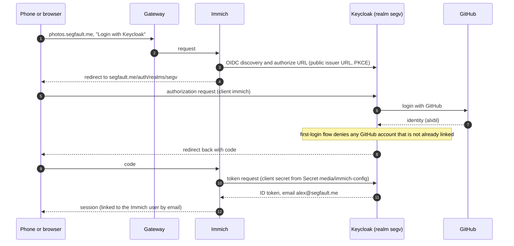
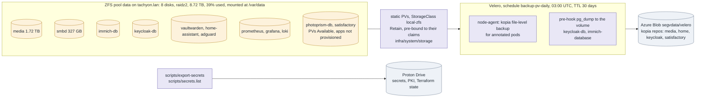
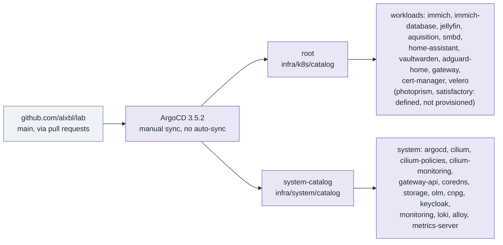

<!-- Generated by Claude Sonnet 5.5 -->
# segv cluster: high-level design

State of the **segv** cluster on 2026-10-24, built from `docs/segv-snapshot-2026-10-21.md` and brought up to date with read-only
`kubectl` and SSH observations plus the Keycloak, Immich, DNS and backup changes made since. It supersedes the `*.drawio` files in
this directory, which predate the cutover and still show Calico, Istio and OpenEBS.

Diagrams are Mermaid and render on GitHub. Versions are those running on the date above.

## 1. Overview

```mermaid
flowchart LR
  classDef ext fill:#eef2f7,stroke:#6b7a90,color:#1f2933
  classDef app fill:#e8f3ea,stroke:#4a8a5a,color:#1f2933
  classDef data fill:#fdf2dc,stroke:#b8872b,color:#1f2933
  classDef sys fill:#e9e7f6,stroke:#6a5fb0,color:#1f2933
  classDef edge fill:#fbe9e7,stroke:#c0614f,color:#1f2933

  subgraph EXT["Internet and external services"]
    users(["Users and phones"]):::ext
    cf["Cloudflare<br/>DNS and proxy<br/>100 MB request cap"]:::ext
    cortex["cortex VM, Azure<br/>sslh, nginx, nghttpx<br/>blog and /auth proxy"]:::ext
    ghrepo["GitHub<br/>alxbl/lab repo"]:::ext
    ghoauth["GitHub OAuth app<br/>identity provider"]:::ext
    le["Let's Encrypt<br/>DNS-01 via Cloudflare"]:::ext
    quad9["Quad9<br/>DNS over TLS :853"]:::ext
    azblob[("Azure Blob<br/>segvdata / velero")]:::ext
    proton[("Proton Drive<br/>secrets and PKI")]:::ext
  end

  subgraph LAN["Home LAN 10.0.0.0/16"]
    lanc(["LAN clients"]):::ext
    udm["UDM 10.0.0.1<br/>router, DHCP, DNS<br/>local DNS records<br/>port-forward 443"]:::ext
  end

  subgraph SEGV["segv: tachyon.lan 10.0.0.6, Fedora CoreOS 44, Kubernetes 1.36.2, containerd 2.3.5"]
    direction TB

    subgraph NSKS["kube-system"]
      cilium["Cilium 1.18.14<br/>kube-proxy replacement, host firewall<br/>WireGuard, Hubble, LB-IPAM + L2"]:::sys
      gw{{"Gateway https-in-gw<br/>10.3.0.2 :80 :443<br/>wildcard cert, source allow-list"}}:::edge
      coredns["CoreDNS 1.13.1<br/>DoT to Quad9, lan zone to UDM"]:::sys
      mets["metrics-server 0.8.1"]:::sys
    end

    subgraph NSCM["cert-manager"]
      cm["cert-manager 1.20.4"]:::sys
    end

    subgraph NSKC["keycloak"]
      kc["Keycloak 26.8.1<br/>realm segv, user alxbl<br/>clients: immich, test-app"]:::app
      kcdb[("keycloak-db<br/>CNPG, Postgres 18")]:::data
    end

    subgraph NSOP["operators, olm, cnpg-system"]
      kcop["Keycloak operator 26.8.1"]:::sys
      olm["OLM 0.46"]:::sys
      cnpgop["CNPG operator 1.30"]:::sys
    end

    subgraph NSMEDIA["media"]
      immich["Immich 3.3.5<br/>server, machine learning, Valkey 9.1<br/>SSO only"]:::app
      immdb[("immich-database<br/>CNPG, VectorChord, Postgres 18")]:::data
      jelly["Jellyfin 12.2"]:::app
      smbd["smbd<br/>SMB :445 on 10.3.0.2"]:::app
      aq["aquisition"]:::app
    end

    subgraph NSHOME["home"]
      adguard["AdGuard Home 10.3.0.53<br/>LAN DNS and ad blocking"]:::app
      ha["Home Assistant"]:::app
      vw["Vaultwarden"]:::app
    end

    subgraph NSMON["monitoring"]
      prom["Prometheus"]:::sys
      graf["Grafana 13.2"]:::sys
      loki["Loki 3.7"]:::sys
      alloy["Alloy 1.21"]:::sys
    end

    subgraph NSARGO["argocd"]
      argo["ArgoCD 3.5.2<br/>app-of-apps, manual sync"]:::sys
    end

    subgraph NSSYS["system"]
      velero["Velero 1.13.0<br/>kopia, daily 03:00 UTC"]:::sys
    end

    zfs[("ZFS pool data, raidz2<br/>8.72 TB, 39% used<br/>datasets data/k8s/*, local-zfs PVs")]:::data
  end

  users --> cf
  cf -->|"segfault.me"| cortex
  cf -->|"vault and photos"| udm
  cortex -->|"/auth over WAN :443"| udm
  udm --> gw

  lanc -->|"split DNS: names resolve to 10.3.0.2"| gw
  lanc -->|"DNS"| adguard
  udm -.->|"DHCP: DNS 10.3.0.53, then 10.0.0.1"| lanc

  gw -->|"/auth"| kc
  gw -->|"photos"| immich
  gw -->|"vault"| vw
  gw -->|"home"| ha
  gw -->|"/watch"| jelly
  gw -->|"/argocd"| argo
  gw -->|"/grafana"| graf

  kc --- kcdb
  immich --- immdb
  immich -->|"OIDC"| kc
  kc -->|"login with GitHub"| ghoauth
  kcop -.-> kc
  cnpgop -.-> kcdb
  cnpgop -.-> immdb
  olm -.-> kcop

  cm -->|"issue wildcard cert"| le
  coredns -->|"DoT"| quad9
  adguard -->|"DoT, UDM as fallback"| quad9
  argo -->|"tracks HEAD"| ghrepo
  prom -.-> graf
  loki -.-> graf
  alloy -.-> loki

  velero -->|"fs backup of home, media,<br/>keycloak, satisfactory"| azblob
  NSKC --- zfs
  NSMEDIA --- zfs
  NSHOME --- zfs
  NSMON --- zfs
  proton -.->|"scripts/export-secrets"| SEGV
```

## 2. Traffic and DNS paths

```mermaid
flowchart TB
  classDef ext fill:#eef2f7,stroke:#6b7a90,color:#1f2933
  classDef app fill:#e8f3ea,stroke:#4a8a5a,color:#1f2933
  classDef edge fill:#fbe9e7,stroke:#c0614f,color:#1f2933

  subgraph A["A. segfault.me: blog and Keycloak login pages, from the internet"]
    direction LR
    a0(["Browser"]):::ext --> a1["Cloudflare proxy"]:::ext
    a1 --> a2["cortex: sslh :443<br/>nginx 127.0.0.1:4443"]:::ext
    a2 -->|"/ blog, static"| a3["static site"]:::ext
    a2 -->|"/auth/"| a4["nghttpx<br/>TLS, certificate verified"]:::ext
    a4 -->|"WAN :443"| a5{{"Gateway 10.3.0.2"}}:::edge
    a5 -->|"realms/segv, resources, js only"| a6["Keycloak"]:::app
  end

  subgraph B["B. vault and photos, from the internet"]
    direction LR
    b0(["Browser or phone"]):::ext --> b1["Cloudflare proxy<br/>100 MB request cap"]:::ext
    b1 -->|"WAN :443"| b2["UDM port-forward"]:::ext
    b2 --> b3{{"Gateway 10.3.0.2<br/>allow-list: LAN, VPN, Cloudflare, cortex"}}:::edge
    b3 --> b4["Vaultwarden or Immich"]:::app
  end

  subgraph C["C. At home: split DNS, no Cloudflare"]
    direction LR
    c0(["LAN client"]):::ext -->|"DNS: 10.3.0.53, then UDM"| c1["AdGuard<br/>rewrites lab, vault, home, photos"]:::app
    c1 -->|"10.3.0.2"| c0
    c0 --> c2{{"Gateway 10.3.0.2"}}:::edge
    c2 --> c3["any app, including Keycloak admin<br/>on lab.segfault.me/auth"]:::app
  end

  subgraph D["D. Cluster DNS"]
    direction LR
    d0["Pods"]:::app --> d1["CoreDNS"]:::app
    d1 -->|"cluster.local"| d2["Kubernetes API data"]:::app
    d1 -->|"lan zone"| d3["UDM 10.0.0.1"]:::ext
    d1 -->|"everything else, DoT"| d4["Quad9, then UDM if both fail"]:::ext
  end
```

| Name | Exposure | Route | Backend |
|---|---|---|---|
| `segfault.me` (apex) | internet, via Cloudflare and cortex | `/auth/realms/segv`, `/auth/resources`, `/auth/js` | Keycloak. The blog is static files on cortex, not in the cluster |
| `vault.segfault.me` | internet, via Cloudflare to home | `/` | Vaultwarden |
| `photos.segfault.me` | internet, via Cloudflare to home; direct on the LAN | `/` | Immich |
| `lab.segfault.me` | LAN only | `/argocd`, `/watch`, `/grafana`, `/auth` (Keycloak admin and `master` realm); `/` redirects to `/watch` | ArgoCD, Jellyfin, Grafana, Keycloak |
| `home.segfault.me` | LAN only | `/` | Home Assistant |
| `smbd` | LAN | SMB :445 on `10.3.0.2` (a `LoadBalancer` sharing the Gateway address) | smbd |

The Keycloak admin console is deliberately not routable from the public host, and only Vaultwarden and Immich sit behind Cloudflare
directly. The UDM serves the split-DNS names as local records; AdGuard serves the same names as rewrites and is the primary
resolver handed out by DHCP.

## 3. Sign-in to Immich

Password login to Immich is off. Keycloak holds one user, `alxbl`, linked to a GitHub identity.

### Adding a user

Done by hand in the live realm, from the admin console on `lab.segfault.me`. The realm import only runs once and never
reconciles, and doing it by hand keeps emails out of git.

1. Realm `segv`, Users, Create user. Set the email to the one on the user's Immich account; Immich links by email.
2. On the user, Identity provider links, link `github` with the account's numeric GitHub id
   (`https://api.github.com/users/<name>`, field `id`) and its username. Keycloak matches on the id, not the name.

Without the link the login completes the GitHub flow and then fails with `access_denied`
(`IDENTITY_PROVIDER_FIRST_LOGIN_ERROR` in the Keycloak log). The GitHub provider requests the `user:email` scope; without
it, accounts with no public profile email fail with `Primary email could not be retrieved from the github endpoint`.

## 4. Storage and backups

- Namespaces in the schedule: `home`, `media`, `keycloak`, `satisfactory`. Only pods that opt in are backed up (Vaultwarden, smbd,
  Home Assistant, both CNPG databases).
- The schedule, location and policy are applied by hand (#62). The old OpenEBS-era repository and the 26 pre-cutover backups were
  deleted on 2026-10-24; the container holds about 279 GB.
- Database secrets and generated client secrets are not in git. They are created by `scripts/keycloak-secrets` and
  `scripts/immich-config`, and exported with `scripts/export-secrets`.

## 5. GitOps

## What changed since the 2026-10-21 snapshot

- **Keycloak 26.8.1** runs through the Keycloak operator (OLM, manual InstallPlan approval) on a CNPG database. Realm `segv` signs
  in with GitHub, admits only `alxbl`, and has the `immich` and `test-app` clients as custom resources.
- **Immich 3.3.5** is deployed in `media` with a CNPG VectorChord database, machine learning and Valkey. It signs in only through
  Keycloak, keeps its configuration in a Secret, and is exposed at `photos.segfault.me` through Cloudflare.
- **cortex** is deployed from the `alxbl/segfault.me` repository (`build/setup.sh`): sslh, nginx and nghttpx, with `/auth` proxied
  to the Gateway over verified TLS.
- **DNS**: CoreDNS is managed by Argo and forwards to Quad9 over DoT; AdGuard uses DoT with the UDM as fallback, and the UDM
  hands out `10.3.0.53` then `10.0.0.1`. The split-DNS names exist as UDM local records and AdGuard rewrites.
- **cert-manager** went from 1.14.4 to 1.20.4. **OLM** and the **CNPG** operator are now synced and running.
- **Monitoring** is present: Prometheus, Grafana (served at `/grafana`), Loki, Alloy, metrics-server.
- **Backups**: `keycloak` joined the schedule, both CNPG databases are dumped by a pre-hook, the OpenEBS repository is gone.
- The `photoprism` route no longer exists, so the `gateway` Application is Healthy.

## Not verified

- Why `home-assistant` and `velero` are OutOfSync at the time of writing (`velero` is expected, see #62); `photoprism` and
  `satisfactory` are Missing by design.
- The router's 443 port-forward and its local DNS records: inferred from the working paths and from DNS answers, not read from
  the UDM.
- Component versions are from container images; AdGuard, Vaultwarden, smbd and aquisition are on `latest` tags.
